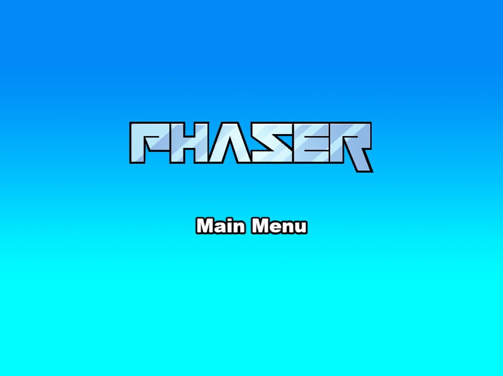

# 大家来找茬

对比上下两张几乎一样的图画，找出所有不同之处，限时闯关。



## 玩法

1. 进入主菜单后点击屏幕开始游戏。
2. 画面上下各有一张图，仔细对比差异。
3. 点到差异位置即可标记成功（上下图点哪边都可以）。
4. 找齐本关全部差异即可通关，进入下一关。

## 规则

- 每关限时 **60 秒**，时间耗尽则挑战失败。
- 每关有 **5 处**差异，顶部圆点显示已找到数量。
- **点错会扣 3 秒**；点到已找到的位置不会重复扣时。
- 局内可打开菜单暂停（倒计时会冻结）。
- 失败后可重新挑战本关，或返回主菜单。

## 关卡

共 **10** 组场景图，例如游乐场、超市、教室、海边等。  
每局会随机打乱关卡顺序，连续挑战。

## 其他

- **设置**：可开关背景音乐与音效。
- **排行榜**：入口已预留，暂未开放。

## 本地运行

```bash
npm install
npm run dev
```

浏览器打开本地地址即可游玩。打包请双击 `打包.cmd`，选择测试或生产环境。
